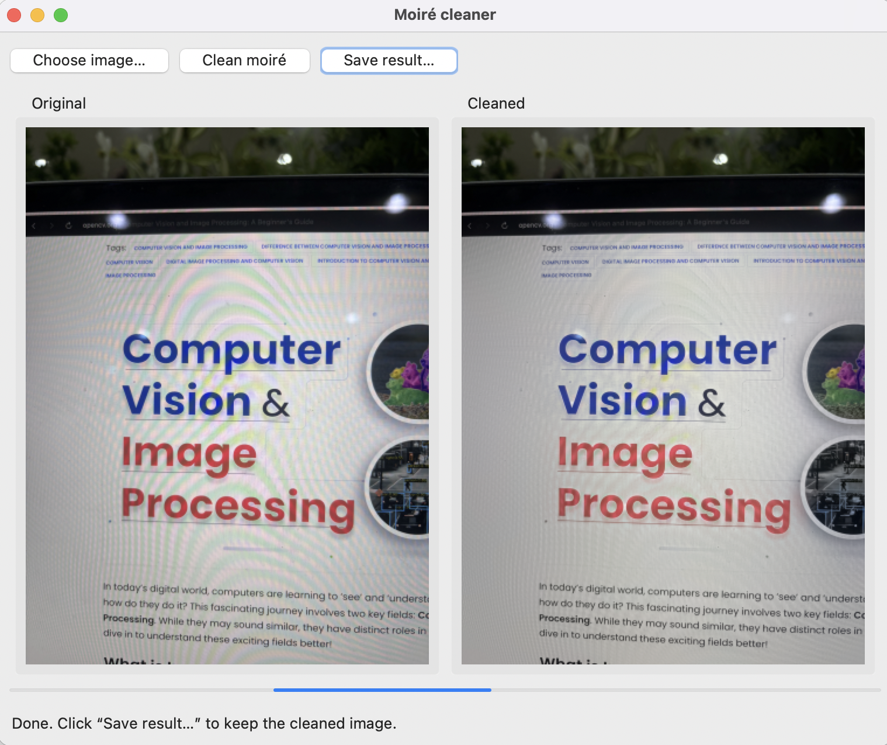
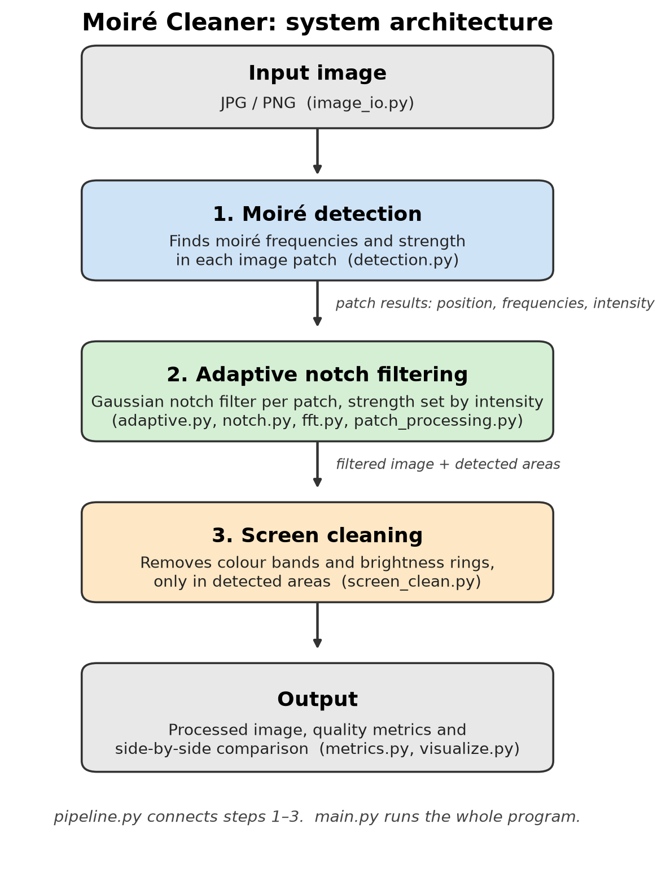

# Moire-cleaner

Moiré-cleaner automatically detects and removes moiré patterns, the wave-like
interference artifacts that appear when you photograph a computer or
smartphone screen. It reduces the moiré while preserving important details
such as text and edges.

## Quick start

1. Download the project and open a terminal in the project folder.
2. Install the requirements:

   ```bash
   pip install -r requirements.txt
   ```

3. Run the program:

   ```bash
   python main.py
   ```

A window opens. Click **Choose image…** and pick any photo from your computer,
click **Clean moiré**, and then **Save result…** to keep the cleaned image.



## How it works



1. **Detection** (`detection.py`): finds the moiré patterns in each part of
   the image and how strong they are.
2. **Notch filtering** (`adaptive.py`, `notch.py`): removes those patterns.
   Parts without moiré are left alone.
3. **Screen cleaning** (`screen_clean.py`): removes leftover colour bands and
   rings, only where moiré was found.
4. **Output**: the cleaned image, quality numbers (`metrics.py`) and a
   side-by-side comparison (`visualize.py`).

`pipeline.py` connects the steps and `main.py` runs the program.

## Project structure

```
main.py             entry point
moire/              the library (detection, filtering, screen cleaning, metrics)
tests/              pytest suite
experiments/        development and evaluation scripts (see experiments/README.md)
data/real/          photos of screens, plus data/real/test/ for extra test photos
data/samples/       synthetic and sample images
docs/               notes and figures
```

## Command line

You can also run without the window by giving an image path. The result is
saved in `results/`.

```bash
python main.py photo.jpg                 # notch filtering + screen cleaning
python main.py photo.jpg --notch-only    # notch filtering only
python main.py photo.jpg --screen-clean  # screen cleaning only
```

The window needs tkinter, which comes with most Python installs (on Linux you
may need to install `python3-tk`). Without it, use the command line.

## Documentation

- [docs/interface-detection.md](docs/interface-detection.md): how detection results are passed to the filter
- [docs/01-explore-spectrum.md](docs/01-explore-spectrum.md): what moiré looks like in the spectrum
- [experiments/README.md](experiments/README.md): overview of the experiment scripts

## Tests

```bash
python -m pytest tests -q
```

