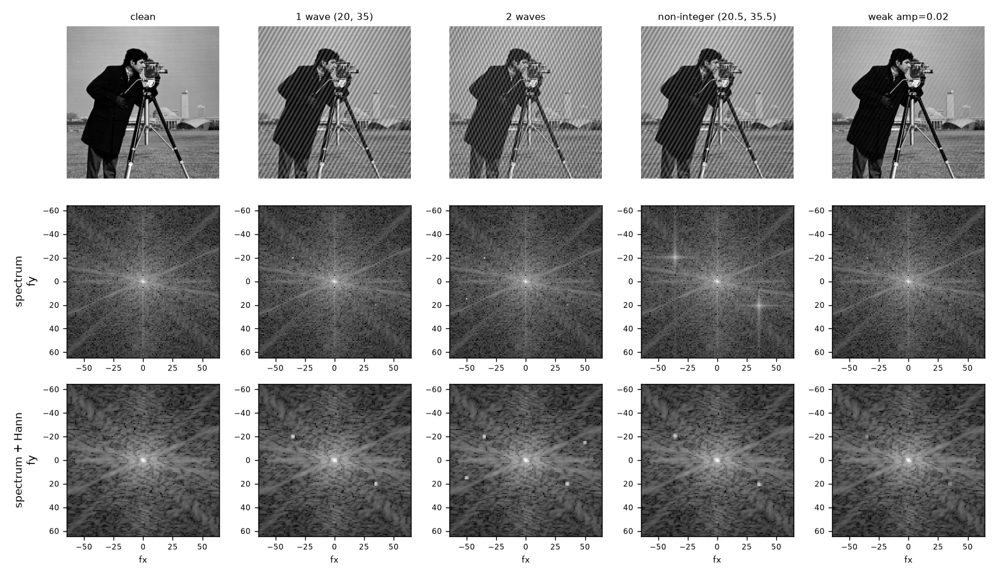

# Experiment 01 – What does moiré look like in the spectrum?

**Script:** [`experiments/explore_spectrum.py`](../experiments/explore_spectrum.py)
**Run:** `python experiments/explore_spectrum.py` (from the repo root)

## Short version

- Moiré shows up in the spectrum as **small bright dots that come in pairs**.
- Normal image content shows up as a **glow in the middle and lines**.
- Looking for the brightest dot does not work. Looking for dots that are
  **much brighter than their surroundings** does.
- Always use a **Hann window**. Without it, some patterns disappear.

## What I did

I added fake stripe patterns to the cameraman image (256×256) and looked at
the spectrum (the FFT) of each one.

| Test | Stripes added |
|---|---|
| clean | none |
| 1 wave | one pattern at (20, 35) |
| 2 waves | two patterns, at (20, 35) and (−15, 50) |
| non-integer | one pattern at (20.5, 35.5) |
| weak | one pattern at (20, 35), but very faint |

Each spectrum is shown twice: plain, and with a Hann window. A Hann window
fades the image to black at the edges before the FFT.

*Top: the images. Middle: spectrum. Bottom: spectrum with Hann window.
The axes show frequency, i.e. how many stripes fit across the image.*

## What I found

### 1. One pattern = two dots

A stripe pattern at (20, 35) gives one dot at (20, 35) and one at
(−20, −35), mirrored through the centre. Both dots are equally bright.
So "2 waves" gives four dots.

### 2. Image content looks different

The real photo gives a bright glow in the middle that fades outward, plus
straight lines. The lines come from strong edges, like the tripod legs.
There are no single isolated dots.

### 3. "Find the brightest dot" does not work

My first detector, `strongest_peak`, just picks the brightest point
(outside the very centre):

| Test | Found | OK? |
|---|---|---|
| clean | (−3, −9) | ✗ finds something that is not there |
| 1 wave | (−20, −35) | ✓ |
| 2 waves | (−20, −35) | only finds one of them |
| non-integer | (−21, −35) | ✓ |
| weak | (−3, −9) | ✗ misses it |

The problem is that the photo itself is brighter near the centre than a
faint pattern.

### 4. "Brighter than the surroundings" does work

Instead, I compared each point with the points around it (the **ratio**).
About 1 means "normal", and a high number means "stands out".

| Test | Without window | With Hann |
|---|---|---|
| clean (highest anywhere) | 5.0 | 3.4 |
| 1 wave | 167 | 48 |
| 2 waves, second pattern | 111 | 39 |
| non-integer | **4.8** | 15 |
| weak | 22 | 7.4 |

With Hann, the clean image never goes above 3.4, and every pattern is
at least 7.4. So a cut-off around **6–8** works for these tests.

### 5. Without a window, some patterns disappear

At 20.5 the pattern falls "between" two FFT points. Its energy then spreads
out into a cross instead of one dot. The ratio drops to 4.8, which is no
higher than the clean image. With Hann it is 15 again.

Real moiré is almost never a whole number, so the window is needed.

Without a window, the edges of the image also make a fake bright cross
through the centre. Hann removes that as well.

### 6. Hann makes dots a bit wider

With Hann, one pattern lights up a few neighbouring points, not just one.
The detector must keep only the brightest point in each spot.

## What the detector should do

1. Apply a Hann window before the FFT.
2. Compare each point with its surroundings, and keep points with a ratio
   above about 6–8.
3. Keep only the brightest point in each spot.
4. Look at only half the spectrum, since each pattern gives two mirrored
   dots.
5. Ignore the very centre (the overall brightness of the image).

## Still unsure

- Will the 6–8 cut-off work on real photos of screens? So far I have only
  tested one image with fake patterns.
- How big should the "surroundings" be? I used 5×5 points.
- Is it worth finding the exact position between two FFT points (e.g. 20.5)?
